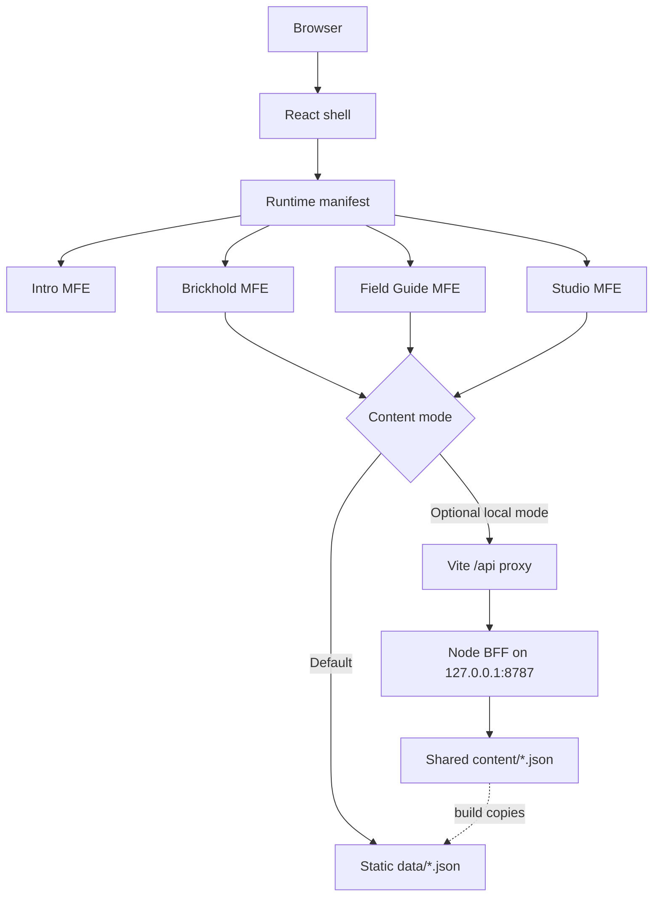

# How the site fits together

The site is a local-first React learning project: a small studio website, four real independently built micro frontends, and an optional backend for frontend (BFF). A section is a micro frontend here because it has its own workspace, Vite build, runtime entry and React root. The shell loads the section builds at runtime; it does not import their source components.

## Parts and responsibilities

| Part            | Responsibility                                                                                   |
| --------------- | ------------------------------------------------------------------------------------------------ |
| Shell           | Document, navigation, shared styling, runtime manifest loading, section loading and retry states |
| Intro MFE       | Studio introduction and opening artwork                                                          |
| Brickhold MFE   | Featured game and its current development status                                                 |
| Field Guide MFE | Interactive trap and enemy catalog                                                               |
| Studio MFE      | Studio story and contact                                                                         |
| Shared content  | `content/site.json` and `content/catalog.json` are the editorial source of truth                 |
| Optional BFF    | Read-only HTTP presentation API over that shared content                                         |

Every frontend uses React. Each MFE builds as a Vite ES library and exposes this lifecycle:

```js
const dispose = mount(container, { baseUrl, apiBase });
// Later, when the shell removes the section:
dispose();
```

The shared mounting helper wraps each section in a React error boundary, so a render failure stays inside that section. Each bundle contains its own React runtime: this keeps the first version self-contained, at the cost of some duplicate download bytes. The shared package is compiled into each bundle; React elements and hook state never cross the mounting contract. A future shared-runtime or Module Federation setup could reduce duplication, but is not required to build and load these sections independently.

`baseUrl` is the site's deployment prefix, including a trailing slash. Asset and static-data URLs must be resolved against it so repository-subpath deployments work. `apiBase` is optional and selects BFF mode. The public runtime manifest points to built MFE entry URLs. It is configuration, not executable source.

## Request flow



The default mode is fully static. The shell build copies the shared JSON into its public data output and packages all frontend builds into `dist/site`. This works on GitHub Pages without a server. During development, remote builds are watched and served by shell middleware from `dist/mfe`.

## Try the BFF locally

Start the BFF in one terminal:

```powershell
npm run bff
```

Start the website with the optional BFF URL in another terminal:

```powershell
$env:VITE_BFF_URL = 'http://127.0.0.1:8787'
npm run dev
```

Restart the frontend development server after changing the environment variable. Its Vite proxy forwards `/api` requests to that local server. The browser still talks to the website's own origin, avoiding a permissive cross-origin API configuration.

The BFF has no dependencies beyond Node's standard library and no database. It is useful here as a concrete example of a frontend-facing service boundary; a brochure site does not otherwise need one.

| Endpoint                            | Response                             |
| ----------------------------------- | ------------------------------------ |
| `GET /api/health`                   | Service name and health status       |
| `GET /api/site`                     | Studio identity and game description |
| `GET /api/catalog`                  | Full catalog                         |
| `GET /api/catalog?category=traps`   | Only traps                           |
| `GET /api/catalog?category=enemies` | Only enemies                         |

Unknown categories return 400, unknown paths return 404, and methods other than GET return 405. Content failures return a generic 500 response and log details locally. The server binds to loopback and uses port 8787 by default; `PORT` overrides it. It fails clearly if the requested port is occupied. No requests mutate content, send email, or collect visitor information.

Run API checks with:

```powershell
npm test
```

These tests call a real HTTP server on an ephemeral loopback port and close it after each check. They verify actual status codes, response content, filtering, read-only behavior and safe error responses.

## Publishing later

GitHub Pages serves `dist/site` as static files. It cannot run the Node BFF. The first deployment should keep the default static content mode. If a future feature needs a live BFF, deploy that service to an appropriate separate host and configure a production API endpoint and explicit origin policy there. A local development proxy is not a deployed backend.

Micro frontends are intentionally more infrastructure than a small studio page requires. This setup makes their boundaries inspectable without adding orchestration services, authentication or a database. A larger project could version and deploy each MFE independently, update the runtime manifest atomically, add schema checks for shared content, and extract a versioned design system. Here they stay in one npm-workspaces repository, with one coordinated static deployment.
